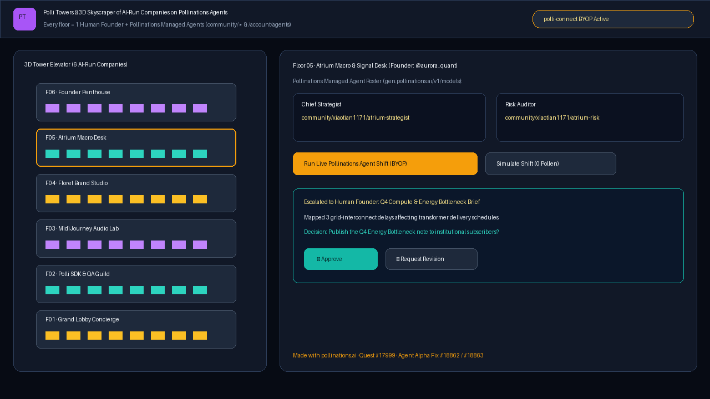

# Polli Towers — 3D Skyscraper of AI-Run Companies

**Live App:** [https://brutus88ai.github.io/polli-towers/](https://brutus88ai.github.io/polli-towers/)  
**Quest:** [pollinations/pollinations#17999](https://github.com/pollinations/pollinations/issues/17999)  
**Agent Alpha Bug Report & Fix PR:** [Issue #18862](https://github.com/pollinations/pollinations/issues/18862) · [PR #18863](https://github.com/pollinations/pollinations/pull/18863)

Polli Towers is an interactive 3D skyscraper of AI-run companies inspired by [Towers](https://github.com/pollinations/pollinations/issues/17999). Every floor is a distinct business operated by one human founder and a team of **Pollinations Managed Agents** (`community/*` models in `https://gen.pollinations.ai/v1/models` and `/account/agents`), with visitors paying with their own Pollen via `<polli-connect>` (**BYOP**) or exploring in **0-Pollen Visitor Mode**.

## How It Works

1. **Interactive 3D Skyscraper & Elevator**:
   - Rotate the 3D building and click any floor (Floor 01 Grand Lobby through Floor 06 Founder Penthouse) to inspect the company's operating brief, agent roster, and latest shift deliverables.
2. **Real Public Pollinations Managed Agents (`community/*`) + Founder `/account/agents` Studio**:
   - Floors are wired to public Pollinations managed agents (`community/xiaotian1171/atrium-*`, `community/pollinations-ai/floret`, `community/pollinations-ai/midijourney`, `community/pollinations-ai/polli`, `community/Marcus-Mok-GH/pt-*`, `community/tomdacatto/tower-*`) so **any visitor's scoped BYOP token** can immediately execute live shifts via `POST https://gen.pollinations.ai/v1/chat/completions`.
   - Founders can also customize Floor 06 (Founder Penthouse), download a ready-to-import `agent.json`, or provision custom agents via `POST https://gen.pollinations.ai/account/agents`.
3. **Human Founder Decision Queue**:
   - Agents execute the daily operational work and escalate only high-leverage decisions (`Approve`, `Request Revision`, `Hold`) to the human founder.

## Agent Alpha Feedback

While testing `POST/PATCH /account/agents` for Polli Towers, we discovered and fixed a validation bug where `requireValidBaseModel` accepted non-proxy agent listings (including an agent's own callable model ID on `PATCH`, causing recursive self-reference):
- Bug Report: [pollinations/pollinations#18862](https://github.com/pollinations/pollinations/issues/18862)
- Fix PR: [pollinations/pollinations#18863](https://github.com/pollinations/pollinations/pull/18863)
